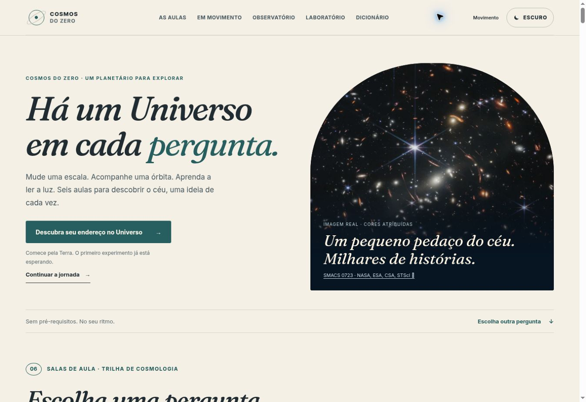
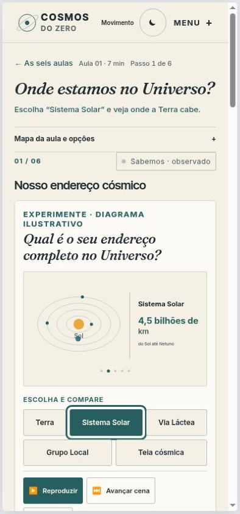
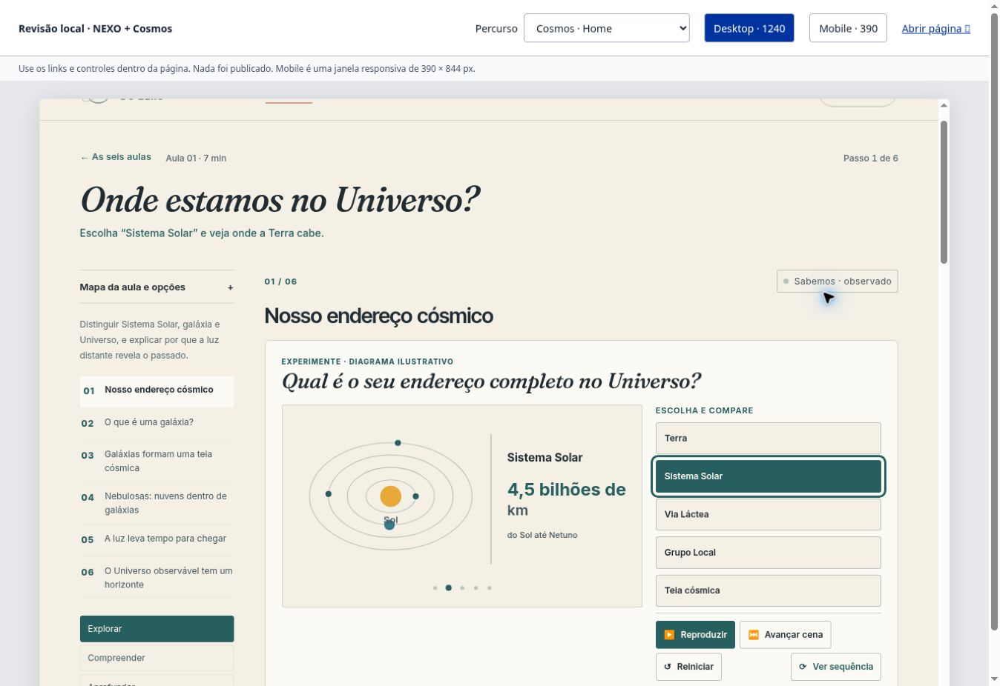

# Cosmos — rework do percurso

Implementação local, sem publicação. Base: `2e9757a51ab2f07b2090b36464638cc0c36ded16` de `byDenoso/TCC`, branch de origem `cosmos/planetario-digital`. Trabalho em `rework/cosmos-20261115`, diretório `cosmos-do-zero`.

## Experiência

Home com uma entrada principal, imagem observacional identificada e seis perguntas visíveis. Cada aula começa com orientação curta, figura e uma ação concreta. Mapa, profundidade e formatos alternativos continuam acessíveis. A sequência de próxima aula percorre as seis aulas.

Os diagramas são a apresentação inicial completa. A vista espacial é opcional para as cenas em que a geometria ajuda. O primeiro experimento aguarda a escolha do aluno; reprodução e sequência automática continuam disponíveis. O mapa de escalas foi redesenhado em SVG, com unidades, medidas e limites explícitos.

Textos científicos, fontes, perguntas de verificação, demais instrumentos, glossário, progresso local e URLs foram preservados. As três aulas centrais mantêm seu progresso e seus selos originais; as seis agora estão conectadas pela navegação sequencial.

## Verificação

- `npm run check`: 263 arquivos, 0 erros, 0 avisos, 0 sugestões.
- `npm test`: 237 testes aprovados, incluindo os modelos científicos existentes.
- `npm run build`: 11 páginas estáticas, incluindo as seis aulas.
- Verificador dos links internos do build: 0 arquivos ou âncoras quebrados.
- Primeira interação das seis aulas verificada em janelas de 1240 e 390 px: escala, expansão, espectro, colapso estelar, disco planetário e diferenciação terrestre.
- Home → chamada principal → primeira aula → “Sistema Solar” verificado pela navegação da interface; a legenda acompanha a escolha.
- Largura do corpo igual à largura de rolagem nos dois tamanhos, sem transbordamento horizontal.
- Percurso sem 3D: primeiro experimento responde, canvas ausente, botão 3D desativado por `?visual=diagram`, avanço entre passos, desafio, oito fontes da primeira aula e passagem para a segunda aula verificados.
- Falha real de WebGL no navegador de revisão: a tentativa de ativar o 3D exibiu a mensagem de indisponibilidade, preservou o SVG e a escolha “Sistema Solar” continuou respondendo. A renderização 3D bem-sucedida não foi verificada neste ambiente.
- Mobile significa janela responsiva de 390 × 844 px; não houve ensaio em aparelho físico.

## Executar

`npm ci`, `npm run build`, `npm run dev` neste diretório.

O painel conjunto está no checkout NEXO, em `review/README.md`, e usa os builds dos dois projetos. Os avisos de tamanho dos módulos 3D continuam no build; esses módulos não são necessários para a primeira interação.

## Capturas

| Desktop | Mobile, 390 px |
| --- | --- |
|  |  |
|  | |

A versão `*-detail.jpg` recorta apenas a moldura do preview. A captura completa também está no diretório.

## Integração para publicação — 15/11/2026

Publicação autorizada posteriormente pelo usuário. O domínio `cosmos.denerpereira.com.br` usa GitHub Pages a partir de `byDenoso/TCC`, branch `cosmos-do-zero`, base `1f09c9c8f15e662f93011b9d73a0bcc715256240`. O rework foi integrado a essa versão, preservando os sete destinos adicionais de exploração, os créditos das imagens e as revisões científicas de produção.

A home mantém quatro seções: entrada, seis perguntas, ciência em movimento e percurso. As 18 páginas foram compiladas; 241 testes unitários, testes HTTP, 358 fragmentos e 1.126 URLs/recursos passaram. Os testes de navegador foram atualizados para seguir o percurso novo: interação inicial em diagrama, abertura explícita do cinema complementar e ativação explícita de 3D.

O workflow existente continua exigindo as verificações de navegador antes de publicar no domínio configurado. O resultado dessa execução deve ser consultado no GitHub Actions; não está presumido neste registro.
