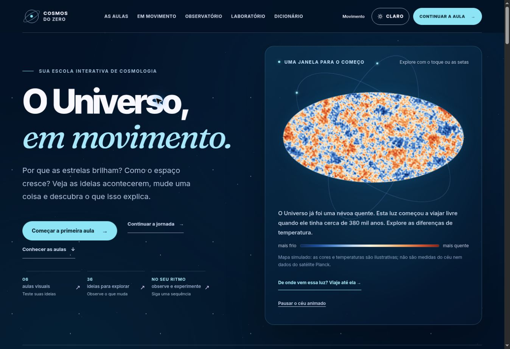
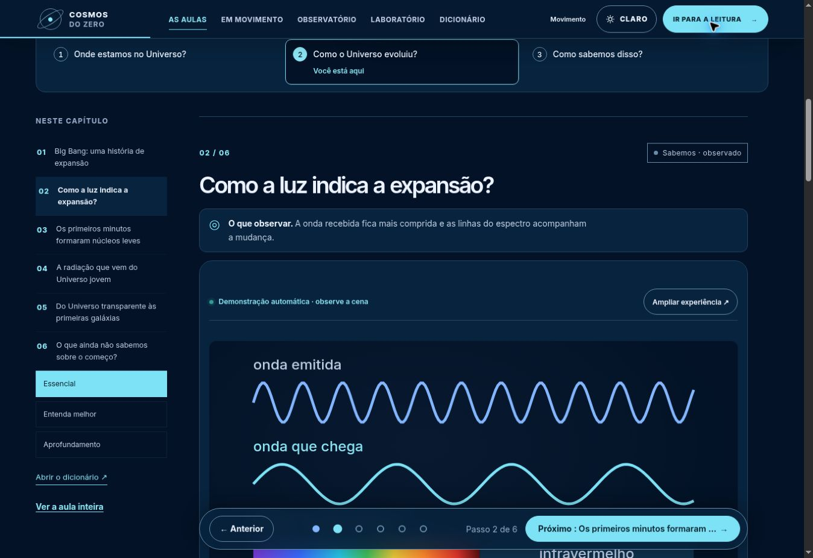
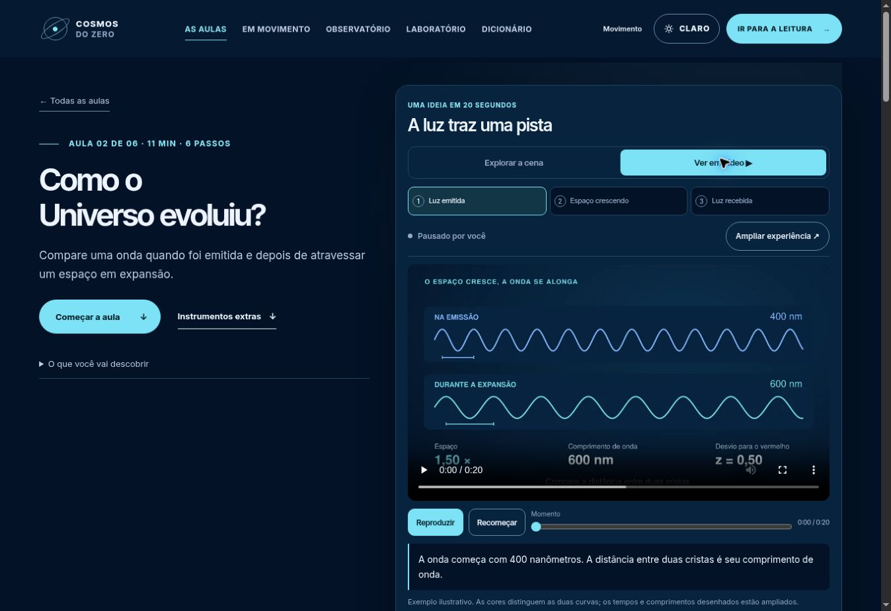
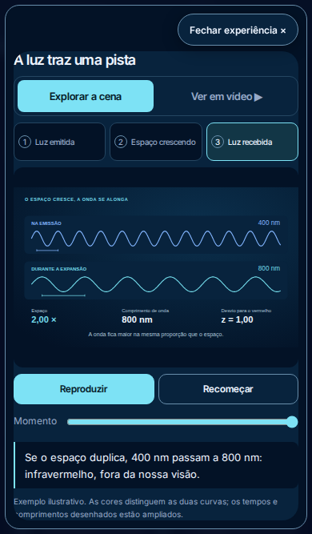
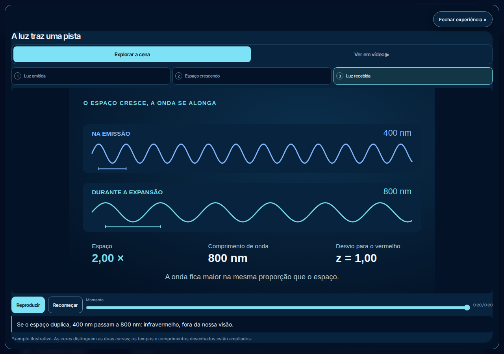
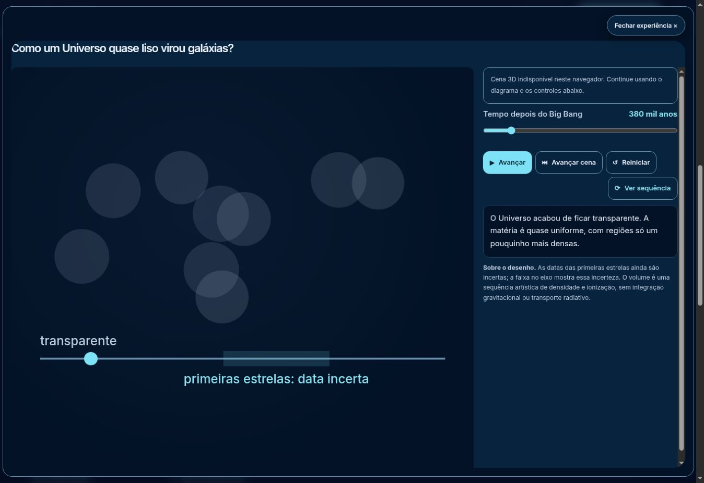
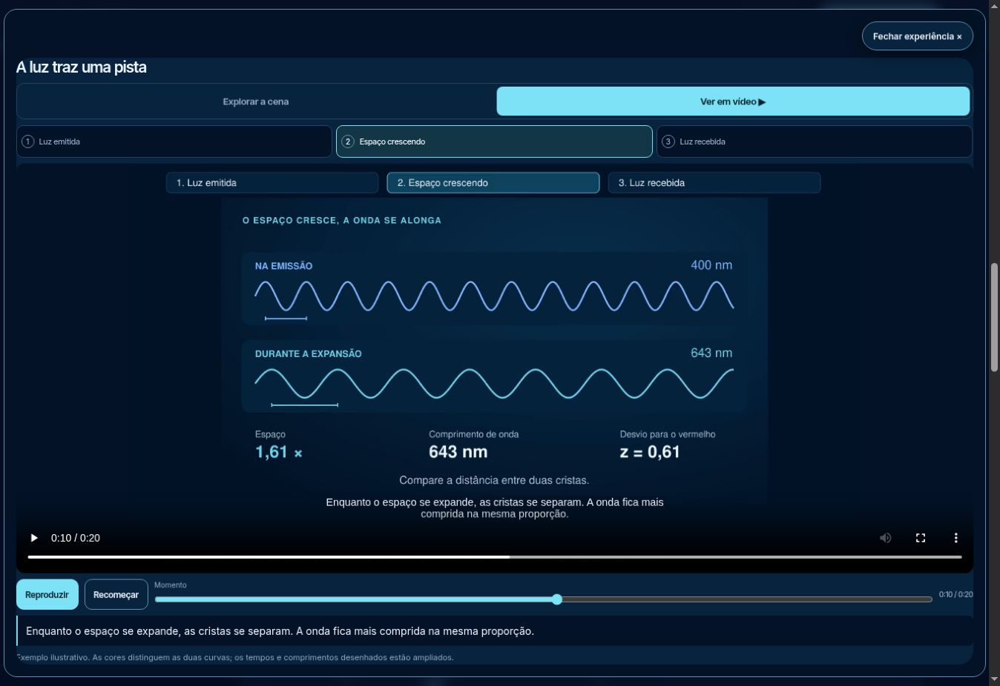

# Cosmos do Zero — continuidade da explicação

## Escopo e decisão

Revisão do percurso entrada → aula → resumo em vídeo → retorno à leitura. A identidade azul profunda e as cenas existentes foram preservadas. O incremento usa os mesmos componentes Astro, SVG e filmes H.264, com um único instante de explicação ao trocar de formato.

| Passo observado | Diagnóstico | Ajuste | Estado da verificação |
|---|---|---|---|
| 1. Entrar na escola e retomar uma aula | Paleta e caminho de retomada claros; a âncora abriu o passo salvo | Estrutura preservada | Conferido na interface publicada |
| 2. Escolher um momento e abrir o vídeo | A cena em 12,6 s voltava a 0 s no vídeo; a legenda começava desligada | Transferência bidirecional de tempo, pausa na troca e legenda portuguesa por padrão | Conferido nos dois domínios publicados; teste de cinema aprovado em 390/1280 px |
| 3. Rever a ideia durante a leitura | O resumo estava apenas na abertura da página | Botão “Rever resumo animado”; o cinema devolve passo, endereço, posição e foco | Conferido na interface publicada; teste de retorno aprovado nas seis aulas em 390/1280 px |

A conferência visual da legenda padrão encontrou texto duplicado sobre o gráfico. Os seis filmes foram regenerados sem a fala gravada no quadro; as legendas VTT ocupam a faixa de leitura do player. Intervalos adjacentes têm separação de 1 ms para que a transição não apresente duas falas ao mesmo tempo. Os desenhos, relações físicas e durações foram preservados.

## Evidência e validação

- Base da continuação: `35e0a4e5ed996e1f873c307f308a06b313cdeb57`. PR de implementação: [202](https://github.com/byDenoso/TCC/pull/202).
- Regressão de continuidade antes da correção: workflow `41745882909`, falha esperada no vídeo que não conservava 11,4 s da cena de galáxias.
- Regressão temporal das legendas: seis testes falharam antes do ajuste; depois, os 178 testes unitários de 18 arquivos passaram.
- Astro e TypeScript: 206 arquivos, sem erros, avisos ou hints.
- Build público e testes de recursos: 11 páginas, 261 fragmentos e 564 URLs/assets; suíte HTTP aprovada. O build mantém o aviso preexistente de pacote acima de 500 kB.
- Filmes: todos conferidos com ffprobe em 1280×720, 24 fps, 480 quadros e 20 segundos. Geometria e estados vêm de `src/lib/story-scenes.ts`.
- Revisão independente do código: aprovada; incluiu tempo pendente, metadados atrasados, troca durante reprodução e restauração do modal.
- O teste de retorno à leitura mede o estado no próprio clique do atalho, antes do handler do modal, e conserva tolerância de 2 px na posição. Isso evita comparar com uma posição anterior à rolagem necessária para alcançar o botão.
- Conferência de navegador antes da publicação: [workflow 41747649728](https://github.com/byDenoso/TCC/actions/runs/41747649728) aprovado: 282 verificações de cinema/transporte, 1109 E2E sem falhas, 8 de céu azul, 54 de shaders, 26 de visibilidade, 34 de dinâmica e 20 imagens.
- Fonte integrada pelo PR202 em `9a5c9c07bdaa22f7f50b9adfe103fc5c884de212`; árvore do aplicativo `ecfd345640de7f2f12b4475b3e9a9b562d083d56`.
- Publicação principal: build e deploy do workflow `41748838865` aprovados. A verificação na URL real aprovou as transições novas e falhou no primeiro Avançar com movimento reduzido. A reprodução controlada do PR203 confirmou uma janela de controles ativos antes do módulo registrar os eventos; ela foi corrigida e revisada. Vercel: deployment `dpl_GQupM2FCNYxnwBSLDgrfm5pJECcR`, READY, com pasta raiz `cosmos-do-zero`; reprodução, legenda padrão, atalho e volta ao SVG conferidos na URL real. Os seis MP4 e seis VTT servidos pela Vercel tiveram seus SHA-256 comparados aos arquivos locais, todos idênticos.

## Capturas da revisão

Capturas reais da interface no mesmo navegador, conservadas sem edição.

## Capturas da nova versão no CI

Origem: artefato `13283564552`, workflow `41747649728`, head `490ea9e148e3220e0669e6136107bd6bb67757a7`. SHA-256 do ZIP conferido: `fbceda427ac6f2118f9b965d8e6ee071190c20a850a56301ad238dc93d207593`. Capturas do preview, antes da publicação; a imagem móvel mostra cena, comandos e explicação dentro de 390×667 px.

## Controles disponíveis depois da preparação

A verificação pública inicial falhou no primeiro Avançar de uma microexperiência com movimento reduzido. A reprodução controlada reteve o módulo da cena e confirmou a janela de controles ativos antes do registro dos eventos: workflow `41751189803`, falha esperada.

O PR [203](https://github.com/byDenoso/TCC/pull/203) usa bloqueio nativo dos controles durante a preparação. O SVG e os handlers ficam prontos antes da liberação; a carga 3D pode continuar separadamente. A interface informa preparação e falha de carregamento. A nova regressão também verifica a primeira interação após a liberação e o estado de preparação acessível.

Astro: 206 arquivos sem diagnósticos e 178 testes unitários aprovados. Revisão independente aprovada; na prévia, o primeiro avanço alterou a régua de 0 para 0,13 e o cinema manteve os comandos visíveis, sem transbordamento horizontal. CI [41751634105](https://github.com/byDenoso/TCC/actions/runs/41751634105) aprovado: 286 verificações de cinema/controles, 1109 E2E sem falhas, 8 de céu azul, 54 de shaders, 26 de visibilidade, 34 de dinâmica e 20 imagens. Nenhuma alteração no modelo físico.

Fonte final do aplicativo integrada pelo PR203 em `bf5ff0ede0618ef1d6a32fc80e92f86870561f1e`, árvore `358183766b8a46a6986e431f20e3fe564f90f1ca`. Vercel final `dpl_Bfuwb2uFqbSUQqQM2Ygo11mdoGby`, READY; primeiro avanço reduzido conferido na URL real, com régua de 0 para 0,13. Publicação principal final pelo [workflow 41753196012](https://github.com/byDenoso/TCC/actions/runs/41753196012): compilação `126323004427` e deploy `126327878323` aprovados.

A primeira tentativa de verificação pública (`126328353691`) aprovou céu e as 286 verificações de cinema/controles, e parou por tempo excedido no clique de Reiniciar do cometa, durante a bateria geral. O log registra o botão visível, habilitado e estável, com a ação de clique em andamento; não determina a causa do atraso. A conferência manual do mesmo reinício, na alternativa SVG do navegador, devolveu a régua de 1 para 0,1, inclusive com movimento reduzido. A etapa pública foi repetida isoladamente, com o mesmo código e os mesmos tempos limite, no job `126331577931`, concluído com sucesso.

A verificação final no domínio principal aprovou 286 verificações de cinema/controles, 1109 E2E sem falhas, 8 de céu azul, 54 de WebGL/shaders, 26 de visibilidade, 34 de dinâmica e 20 imagens. Compilação, publicação e verificação pública terminaram com sucesso. O prompt e as capturas desta continuação foram integrados pelo [PR204](https://github.com/byDenoso/TCC/pull/204), preservando a árvore do aplicativo publicada.

## Resultado publicado

Conferência manual em [Como o Universo evoluiu?](https://cosmos.denerpereira.com.br/capitulos/origem-do-universo/#origem-do-universo-expansao), após o deploy final: a microexperiência usa `FIELDSET`, termina com `aria-busy=false` e responde ao primeiro avanço reduzido, de 0 para 0,13. A preferência anterior de movimento e o passo 2 da leitura foram restaurados.

O resumo abriu durante a leitura, passou da cena para o vídeo em 5,4 s, reproduziu com a faixa portuguesa ativa por padrão e voltou à cena no instante intermediário escolhido. Ao fechar, o endereço permaneceu no passo 2 e o foco voltou a “Rever resumo animado”. Os seis MP4 e seis VTT dos dois domínios publicados foram comparados por SHA-256 aos arquivos do código, todos idênticos; a correção de prontidão preservou esses arquivos.

Captura real do vídeo pausado em aproximadamente 10,33 s, com legenda nativa, valores e comandos visíveis. SHA Git da imagem: `672abd96dd19fb4659421d1270af0e223a7d9ab3`.

## Limites da conferência

Os vídeos continuam sem narração, com explicação escrita e legendas em português. O vídeo tem resolução temporal de 1/24 s; nas transições, seu quadro pode anteceder o instante contínuo do SVG em até um quadro. A inspeção manual usou o navegador em desktop; o celular é exercitado pelos testes e capturas do CI. Esta revisão de interface não constitui certificação integral de acessibilidade.
