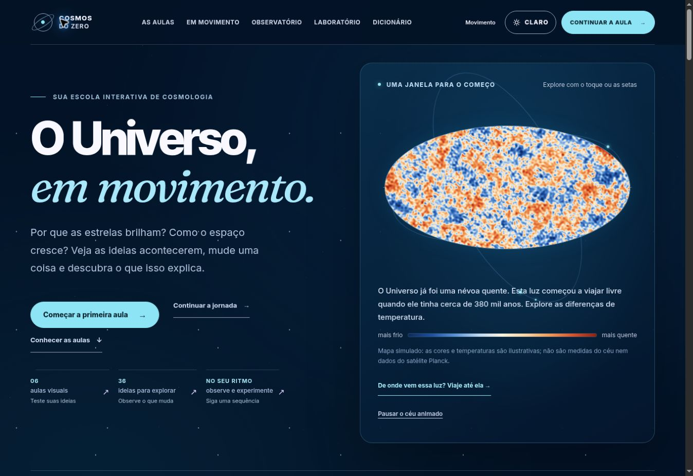
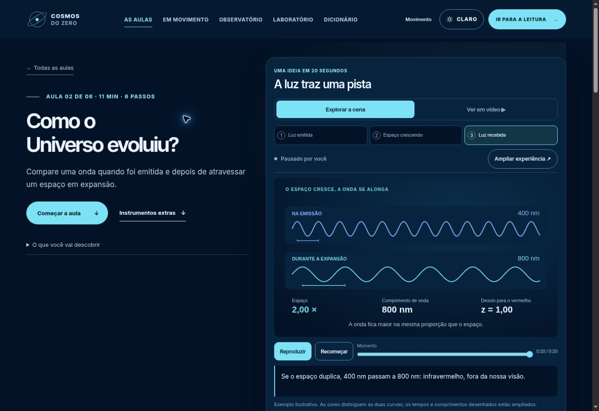

# Cosmos do Zero — escola audiovisual em azul profundo

## Resultado

O rework usa azul profundo como fundo e aproxima as explicações de cenas que o aluno pode observar e controlar. A entrada apresenta uma demonstração antes do catálogo; as seis aulas têm capas em SVG e uma abertura visual de 20 segundos, com três momentos nomeados e a opção de assistir ao vídeo equivalente.

Os vídeos são arquivos H.264 em 1280×720, 24 quadros por segundo, sem áudio, com legendas VTT em português e transcrição na aula. SVG e vídeo usam a mesma biblioteca de geometria e estados. As relações físicas e as simplificações aparecem nas explicações e nos limites de cada desenho.

A pausa, a escolha de etapa e a régua prevalecem sobre a reprodução automática. Voltar do vídeo conserva a escolha feita na cena. O modo cinema mantém Fechar acessível e permite rolar o conteúdo em celulares deitados. Escape devolve o foco ao botão original.

URLs, progresso, desafios, fontes e as 36 experiências existentes continuam disponíveis. A base Astro, Three.js e GSAP foi reaproveitada; as novas cenas e capas são SVG nativos.

## Verificação da implementação

Fonte integrada pelo [PR 198](https://github.com/byDenoso/TCC/pull/198), commit `30cc9df29ee33e35f37b8d67393cea6afc8fd2ff` da branch Cosmos. O [PR 199](https://github.com/byDenoso/TCC/pull/199), commit `9ae0a8b28950776276a3684b57be1232afbeba22`, também alinhou a nebulosa WebGL à paleta azul. O teste de pixels falhou com a paleta antiga (75,1% de azul/ciano entre os pixels analisados) e aprovou a nova nas duas larguras. A revisão independente identificou três regressões de transporte, histórico e celular deitado; as correções foram revisadas antes da integração.

O [PR 201](https://github.com/byDenoso/TCC/pull/201), commit final do app `92272aa265451172e787353dbd2f062cc5e77732`, corrigiu um pedido de reprodução perdido quando a leitura de visibilidade chegava atrasada. O caso foi reproduzido com atraso de 200 ms no observador: o primeiro clique era ignorado mesmo com o palco na tela. Agora o pedido aguarda a visibilidade; pausar, reiniciar ou mover a régua o cancela. O teste também exige que Avançar realmente altere o quadro com movimento reduzido.

| Verificação na versão publicada | Resultado |
|---|---|
| Astro e TypeScript | 205 arquivos; nenhum erro, aviso ou hint |
| Testes unitários | 172 aprovados em 17 arquivos |
| Site público | 11 páginas, 261 fragmentos e 564 URLs/assets |
| Cinema, vídeos e transporte | 170 verificações aprovadas |
| Céu azul em WebGL | 8 verificações de pixels aprovadas em 390/1440 px |
| WebGL e shaders | 54 verificações aprovadas |
| Reprodução por visibilidade | 26 verificações aprovadas |
| Dinâmica e preferências | 34 verificações aprovadas |
| Navegação e interações | 1109 verificações, nenhuma falha |
| HTTP e imagens | Suítes aprovadas |

O cinema foi exercitado em 390×667, 1280×900 e 667×375. O teste de histórico confirmou a navegação e a pausa fora da tela; nessa execução o navegador informou `cache restaurado = false`, portanto ela não comprova uma restauração específica pelo BFCache. O tratamento desse ciclo foi conferido na revisão do código.

## Publicação

- Vercel: [cosmos-do-zero.vercel.app](https://cosmos-do-zero.vercel.app/), deployment final `dpl_51h85XwxmF9WsHBucTQ697C3L1oB`, estado READY, com as correções de GPU e transporte. Os seis vídeos foram abertos e reproduzidos no endereço real; todos informaram largura de 1280 pixels e duração de 20 segundos. A reprodução e a pausa da cena corrigida também foram conferidas na interface publicada.
- Domínio principal: [cosmos.denerpereira.com.br](https://cosmos.denerpereira.com.br/); publicação e validação da versão final pelo [workflow 41722894450](https://github.com/byDenoso/TCC/actions/runs/41722894450), com build, deploy e verificação pública concluídos com sucesso. A validação no domínio terminou às 21:56 UTC de 3 de novembro de 2026; os seis vídeos também foram abertos e reproduzidos na conferência visual desse endereço.

O prompt reutilizável está em [COSMOS_PROMPT_REWORK.md](COSMOS_PROMPT_REWORK.md). O gerador de mídia e a procedência estão no projeto, junto das seis cenas.

## Capturas da publicação

As imagens abaixo são capturas reais da interface no navegador de verificação. Nesse ambiente, o céu usa a alternativa sem GPU; as cores do shader foram verificadas pelo teste de pixels em WebGL.

